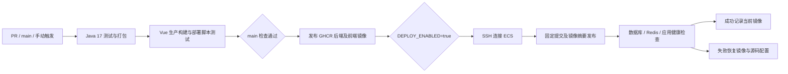

# GitHub Actions → 阿里云 ECS

工作流为 `.github/workflows/ci-cd.yml`。面向一台 Linux x86_64 ECS，使用现有 Docker Compose 编排，不要求在 ECS 安装 Java、Maven 或 Node.js。

## 流程



- PR 只测试和构建，不访问部署凭据、不发布镜像。
- CI 使用独立 PostgreSQL/Redis，执行 5 项 OSS 单元测试、6 项 PostgreSQL 集成测试及部署脚本测试，不连接生产数据库或 OSS。
- 前端运行 `npm run build`。原有严格类型检查错误尚未修复，因此 `type-check` 暂未设为 CI 门禁。
- `main` 检查通过后生成两个 `linux/amd64` 镜像，标签为提交 SHA；ECS 实际拉取 `@sha256:...` 摘要。
- 镜像示例：`ghcr.io/lincx2026/pdca-erp-backend`、`ghcr.io/lincx2026/pdca-erp-frontend`。
- 自动部署仅作用于 `main`；手动运行默认只检查和发布镜像，勾选 deploy 才执行 CD。仓库未设置 DEPLOY_ENABLED 时跳过 CD。
- 部署按 production 并发组串行执行，运行中的部署不会被新提交取消；ECS 上另用 flock 加锁。落后于当前 main 的任务不会覆盖服务器。

## ECS 首次准备

### 共享 ECS（已有 PostgreSQL、Nginx 和其他项目）

生产环境 Secret `ERP_ENV` 保存完整运行 `.env`，仅 production 部署和只读预检使用，不进入镜像或 Git。首次发布会在目标目录不存在时克隆仓库，并以 0600 权限创建 `.env`；已有服务器 `.env` 不会被覆盖。后续运行配置须在服务器同步更新，更新 Secret 仅影响首次初始化和预检。

运行配置设置 `DEPLOY_MODE=shared`，填写既有 PostgreSQL 的 DB_HOST、DB_PORT、POSTGRES_DB、POSTGRES_USER、POSTGRES_PASSWORD、DB_SSLMODE，并设置域名和 CORS。另设：

```dotenv
ERP_DOMAIN=erp.thinkfiter.com
CORS_ALLOWED_ORIGINS=https://erp.thinkfiter.com
ERP_HTTP_PORT=18080
BACKEND_PORT=18081
ERP_REDIS_PORT=16379
ERP_TLS_CERT=/etc/letsencrypt/live/your-domain/fullchain.pem
ERP_TLS_KEY=/etc/letsencrypt/live/your-domain/privkey.pem
```

证书路径指向服务器上覆盖正式域名的有效证书。共享模式要求 Linux、Compose >= 2.24.4、Python >= 3.6、psql、pg_dump、Nginx、OpenSSL、curl。后端和前端使用主机网络并仅监听回环地址，Redis 仅发布回环 16379；不启动 Compose PostgreSQL、不占用已有 Redis 6379。选定端口须未被占用。

部署先只读验证数据库连接和结构，拒绝自动迁移缺少 ERP/Flyway 标记的非空数据库；每次应用切换前通过 pg_dump 备份目标库到 `.deploy-backups/database-before-*.dump`。空库允许 Flyway 初始化，但不会自动迁入本机历史业务数据。已有非 Flyway ERP 数据库应先完成可审查的离线迁移，不能自动 baseline。

仅管理 `/etc/nginx/conf.d/pcba-erp.conf`，拒绝覆盖无管理标记的文件或抢占已有同域名虚拟主机。引用已有证书，执行 `nginx -t` 后平滑 reload，并验证带有效 TLS 的 HTTPS readiness；失败恢复 ERP 虚拟主机和可用旧镜像。其他站点配置、数据库实例和证书文件不作修改。

首次发布前运行 Actions 的 **ECS read-only preflight** 查看连接、端口、域名和证书检查；预检不会创建业务表或修改服务。正式域名 DNS 应指向该 ECS。

### 独立 ECS（默认 standalone 模式）

安装 Git、Bash、Docker Engine、Compose v2、flock（util-linux）。部署账号需要目标目录写权限和 Docker 权限。
ECS 需能访问 github.com、ghcr.io 及基础镜像仓库；网络不通时先配置网络出口或改用可访问的镜像仓库。
安全组开放域名服务的 80/443，以及供 Actions 连接的 SSH 端口；数据库和 Redis 仅绑定回环地址。

以部署账号执行：

```bash
git clone https://github.com/lincx2026/pdca-erp.git /opt/pcba-erp
cd /opt/pcba-erp
python3 scripts/init-env.py
mkdir -p docker/nginx/ssl
```

在 ECS 本机编辑 `.env`，填写生产域名、OSS、CORS、数据库和 Redis 配置，放置域名证书：

- `docker/nginx/ssl/fullchain.pem`
- `docker/nginx/ssl/private.key`

首次构建镜像在 Actions 完成；服务器不需要执行 `deploy.sh all`。已有 MySQL 数据必须先按 README 迁入新 PostgreSQL 库，再启用自动部署。
如果已有生产 PostgreSQL，核对 Compose 命名卷 POSTGRES_VOLUME_NAME，避免误连空库。运行数据与 `.env`、证书不会通过 Actions 上传或覆盖。
服务器已跟踪的源码文件应保持干净，定制域名等参数写在 `.env`；脏工作区会阻止自动切换版本。
不要在自动部署期间同时手工运行 deploy.sh。每次数据库变更前备份，Flyway 迁移须兼容前一应用版本。

## GitHub 配置

在仓库 Settings → Environments 创建 `production`，部署分支限制为 main。在该环境添加 Secrets：

| Secret | 内容 |
| --- | --- |
| ECS_HOST | ECS 公网 IP 或可解析主机名，不带协议和端口 |
| ECS_USER | 专用 SSH 部署账号 |
| ECS_SSH_KEY | 该账号的专用 SSH 私钥，使用无口令自动化密钥 |
| ECS_KNOWN_HOSTS | 经可信渠道核对指纹后的 SSH known_hosts 完整记录；非 22 端口记录使用 `[host]:port` |

私钥对应的公钥需要放入 ECS 部署账号的 `~/.ssh/authorized_keys`。
不关闭主机指纹校验，不将私钥、`.env` 或 OSS 凭据提交仓库。可以在可信管理机采集公钥后，与 ECS 控制台/管理员提供的指纹核对，再保存到 Secret。

在 Settings → Secrets and variables → Actions → Variables 添加**仓库级**变量：

| Variable | 默认值 / 用途 |
| --- | --- |
| DEPLOY_ENABLED | 填 `true` 开启 CD；未设置时仅 CI 和镜像发布 |
| DEPLOY_PATH | `/opt/pcba-erp`，绝对路径，仅使用字母、数字、下划线、连字符及 `/` |
| ECS_PORT | `22` |

GHCR 发布使用工作流自动生成的 GITHUB_TOKEN，无需另填长期仓库令牌。工作流给发布 job packages:write，部署 job packages:read；镜像 source 标签关联本仓库。
首次发布后检查 GHCR 包的 Actions access 是否允许本仓库读取；不要公开业务镜像来绕过权限问题。
ECS 登录 GHCR 使用该次任务的临时令牌和临时 Docker 配置目录，任务结束后清理，不将令牌长期保存到服务器默认 Docker 配置。

## 发布、回滚与排查

推送 main 自动执行 CI/CD；也可在 Actions → CI and ECS deployment → Run workflow 手动运行。
配置完 Secrets 和变量后手动运行一次并勾选 deploy；查看三个 job：ci、publish、deploy。

在 ECS 查看状态或回滚镜像：

```bash
cd /opt/pcba-erp
bash deploy.sh status
bash deploy.sh rollback
```

当前镜像记录在 `.deploy-backups/current.env`，上一完整镜像快照在 `.deploy-backups/previous.yml`，最近成功的 CD 提交在 `.deploy-backups/revision`。
直接执行 Compose 命令时需要同时传入 `.env` 与 `.deploy-backups/current.env`，否则会使用 Compose 默认 local 镜像。
自动发布失败会恢复之前的 Git 提交和配置，并使用现有镜像回滚机制恢复应用；首次发布没有旧版本时只能报告失败，需修复后重跑。
手工 `deploy.sh rollback` 仅恢复应用镜像，不回滚 Git 配置或数据库；配置回退需结合相应 Git 版本处理。数据库恢复应单独演练。
不会执行历史 MySQL SQL、删除数据库卷或清理已有业务数据。

若 CI 失败，在 Test reports 下载 JUnit XML；前端构建错误在 Frontend production build。
SSH 失败核对账号、公钥、主机指纹和安全组；拉取镜像失败核对 GHCR 权限和 ECS 网络出口。
健康检查失败在 ECS 使用 Compose logs 查看原因，日志输出不要包含 `.env` 或完整 Compose 展开配置。

实现依据：[GitHub 镜像发布](https://docs.github.com/en/actions/tutorials/publish-packages/publish-docker-images)、[GHCR 权限](https://docs.github.com/en/packages/working-with-a-github-packages-registry/working-with-the-container-registry)、[部署环境](https://docs.github.com/en/actions/concepts/workflows-and-actions/deployment-environments)。
